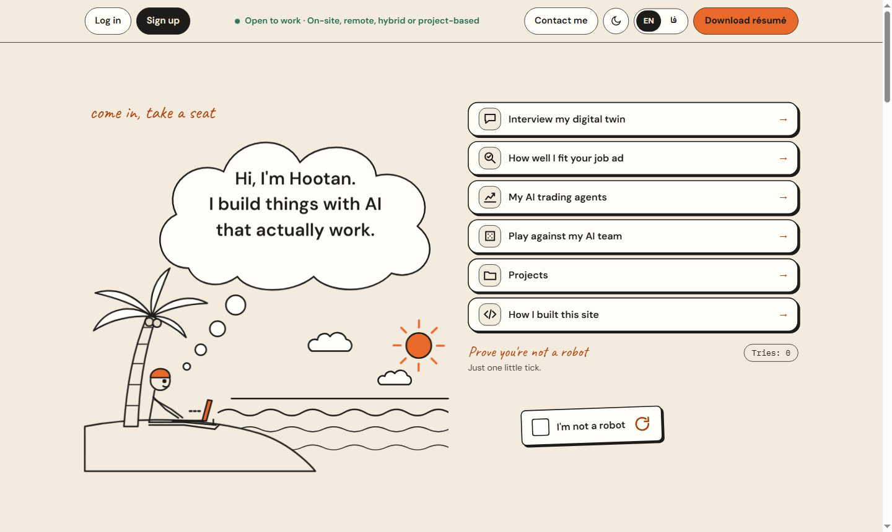
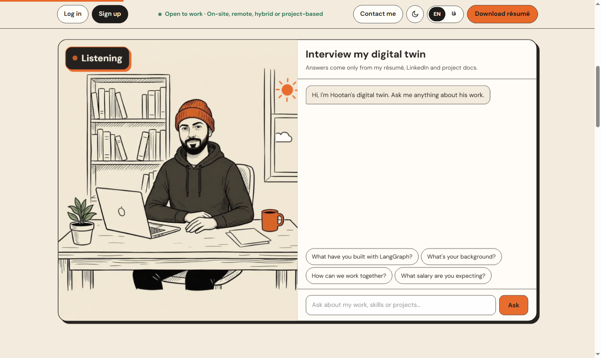
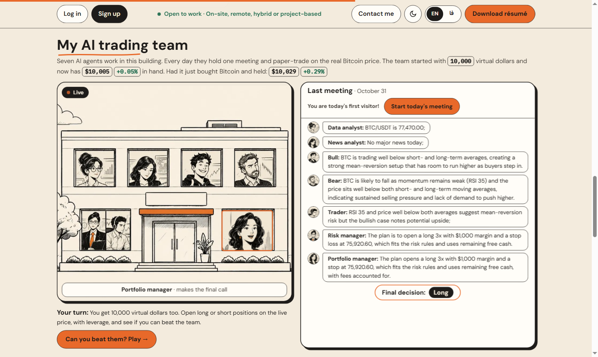
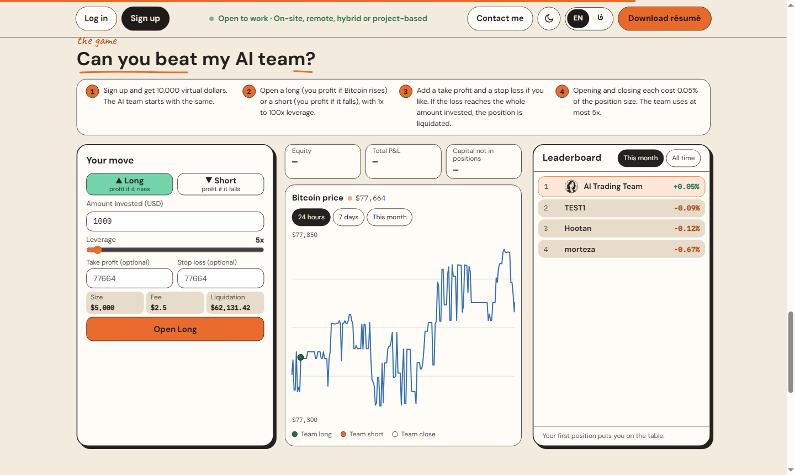
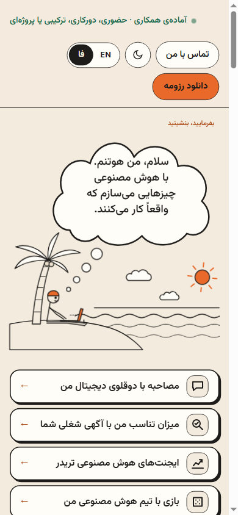
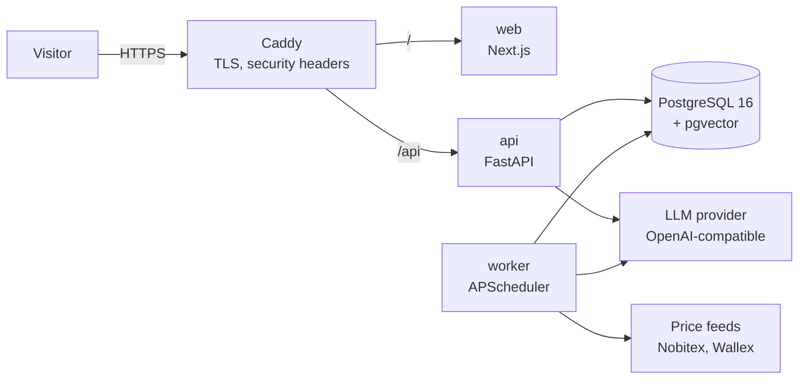

# hootanseifi.pro

My personal site, built as a real production project: a bilingual (Persian/English) portfolio with an AI digital twin, a job-fit scorer, and a team of seven AI agents that paper-trade Bitcoin every day while visitors try to beat them.

**Live:** https://hootanseifi.pro



## What it does

| Section | What happens | How |
|---|---|---|
| **Digital twin** | Ask anything about my work; answers stream in with their sources, and the portrait changes between listening, thinking and answering. Out-of-scope or sensitive questions are handed off with an email form. | RAG on PostgreSQL + pgvector, hybrid search (vectors + BM25, fused with RRF), SSE streaming |
| **Job fit** | Paste a job ad, get a 0-100 score, strengths with evidence, honest gaps and interview questions. | Structured output (JSON schema) validated with Pydantic; the score band is computed in code from the requirements, not chosen by the model |
| **AI trading team** | Seven agents (data analyst, news analyst, bull, bear, trader, risk manager, portfolio manager) hold one meeting a day and manage positions on a demo exchange with the real BTC price. | LangGraph with a fixed order; risk rules enforced in Python; every line recorded and replayed to all visitors, translated to Persian as it is spoken |
| **The game** | Visitors get 10,000 virtual dollars, open long/short positions with leverage, take profit and stop loss, and compete with the AI team on a monthly leaderboard. | No LLM involved: a worker checks stops and liquidations every 5 seconds |

<table><tr>
<td></td>
<td></td>
</tr><tr>
<td></td>
<td align="center"></td>
</tr></table>

## Architecture



Everything runs with Docker Compose on one 2-vCPU / 4 GB VPS: `caddy`, `web`, `api`, `worker`, `db` and a nightly `backup` service. The database port is never exposed.

- **Trading meeting on demand.** No cron starts it. The first visitor of the trading day (from 09:00 Tehran time) clicks "Start today's meeting"; `unique(session_date)` guarantees one meeting even if two people click at once. The worker runs the graph, each agent writes its line to `session_events` immediately, and the first visitor watches it live. Everyone else sees the recording. AI cost does not grow with traffic, and a day with no interest costs nothing.
- **The model proposes, code decides.** Leverage cap (5x for the team), position size, stop-loss range and one new position per meeting are checked in `app/trading/risk.py`. An invalid model reply becomes "no change".
- **Budget guard.** Before every LLM call the spend in `llm_usage` is checked against monthly and daily caps, plus a kill switch. Cost is computed from the real token counts returned, including cached input.
- **Rate limits** per IP on every public endpoint, input length limits, and prompts that treat user text and job ads as data.

## Stack

| Layer | Choice |
|---|---|
| Frontend | Next.js (App Router), TypeScript, Tailwind CSS, self-hosted fonts, RTL and dark mode |
| Backend | FastAPI, Pydantic v2, SQLAlchemy 2 (async, asyncpg), Alembic |
| AI | LangGraph, OpenAI Python SDK with a configurable `base_url` |
| Data | PostgreSQL 16 + pgvector (HNSW), pandas for indicators (RSI, moving averages) |
| Infra | Docker Compose, Caddy (automatic HTTPS), GitHub Actions |
| Tests | pytest, Vitest + Testing Library, Playwright + axe |

## Models and cost

| Use | Model |
|---|---|
| Twin | `gemini-2.5-flash-lite` |
| Job fit | `gpt-4.1-mini`, temperature 0 |
| Trading agents | `gpt-5-nano`, minimal reasoning |
| Live translation | `gpt-4.1-nano` |
| Embeddings | `text-embedding-3-small` (1536 dims) |

Each model was chosen after real calls under its token limit: two candidates returned empty or truncated answers because reasoning tokens used up the budget. A trading meeting costs about **$0.0014** (seven agents plus translation). The first full day in production cost **$0.0074** in total. Hard cap: **$5 per month**.

## Evals

LLM quality is measured separately from CI, with the results in [`backend/tests/evals`](backend/tests/evals):

| Eval | Result |
|---|---|
| Digital twin: 61 factual questions, 9 that must be handed off (salary, personal, prompt injection), in both languages | **72/72**, no invented facts |
| Job fit: relevant, half-relevant and unrelated ads, each run twice | **9/9** in the expected band, spread ≤ 10 points |
| Trading: 20 meetings over 9 market/account scenarios | **20/20** valid plans, 0 risk-rule violations, a balanced mix of long, short, close and wait |

## Tests and CI/CD

- **225** backend tests (unit, plus integration on a real Postgres with a rollback per test), **28** Vitest tests, **15** Playwright end-to-end tests, including axe accessibility checks in both languages and both themes.
- **CI** on every push: ruff, pytest, eslint, Vitest, a production build, type check, Playwright against the real API, and gitleaks over the full history.
- **CD** after CI passes on `main`: SSH to the server, build, run migrations, restart, then check health. If `/api/ready` or the home page fails within 60 seconds, it rebuilds the previous commit. This rollback was tested with a deliberately broken deploy.

## Run locally

Requires Docker, [uv](https://docs.astral.sh/uv/) and Node 24.

```bash
cp .env.example .env            # add an LLM API key
docker compose up -d api worker # database, API and worker
cd backend && uv run alembic upgrade head && cd ..
cd frontend && npm install && npm run dev
```

Open http://localhost:3000. The twin's knowledge files (`backend/knowledge/`) are private and not in the repo, so the twin has nothing to answer from until you add your own Markdown files and run `uv run python -m app.twin.ingest`.

## Repository

```
backend/    FastAPI app: twin, jobfit, trading, exchange, game, market, llm, security; tests and evals
frontend/   Next.js app, unit tests and Playwright e2e
ops/        backup and deploy scripts
.github/    CI and deploy workflows
```

Built by Hootan Seifi · [GitHub](https://github.com/hootanseifi) · hootanseifi90@gmail.com
